# GoZipo

GoZipo is a ride-hailing project built with **Kotlin Multiplatform** and **Compose Multiplatform**. One repository builds two apps for **Android and iOS**, with the UI fully shared in Compose:

| App | Who it's for | Android app ID |
|---|---|---|
| **GoZipo** | Customers who book rides | `com.mobile.gozipo` |
| **GoZipo Rider** | Riders (drivers) who take rides | `com.mobile.gozipo.rider` |

Main features:

- Email/password and passkey sign-in, with separate customer and rider accounts
- Live map with place search, routes and turn-by-turn navigation for riders
- Customers name their fare and riders send offers (fares in PKR)
- Real-time ride updates over WebSocket, plus push notifications
- Card payments with Stripe (Visa, Mastercard, Google Pay, Apple Pay); cash still works
- Rider vehicle management and earnings history
- Light and dark themes

The backend is a separate Spring Boot (Kotlin) project.

## Screenshots

### GoZipo (customer)

<table>
  <tr>
    <td align="center">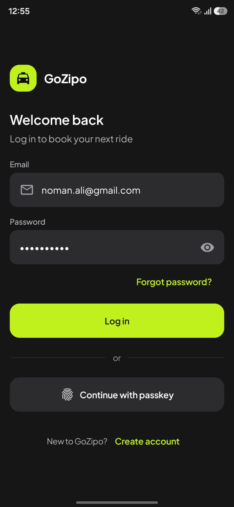<br/>Login</td>
    <td align="center">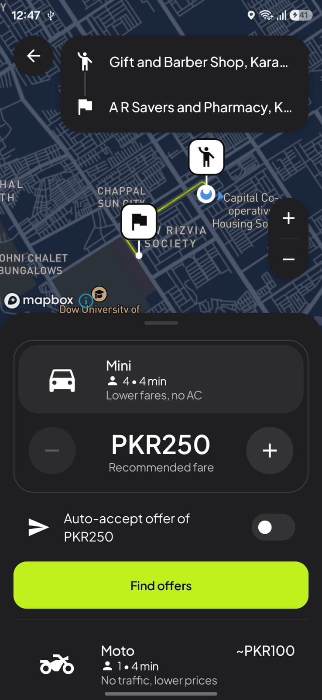<br/>Select vehicle and fare</td>
    <td align="center">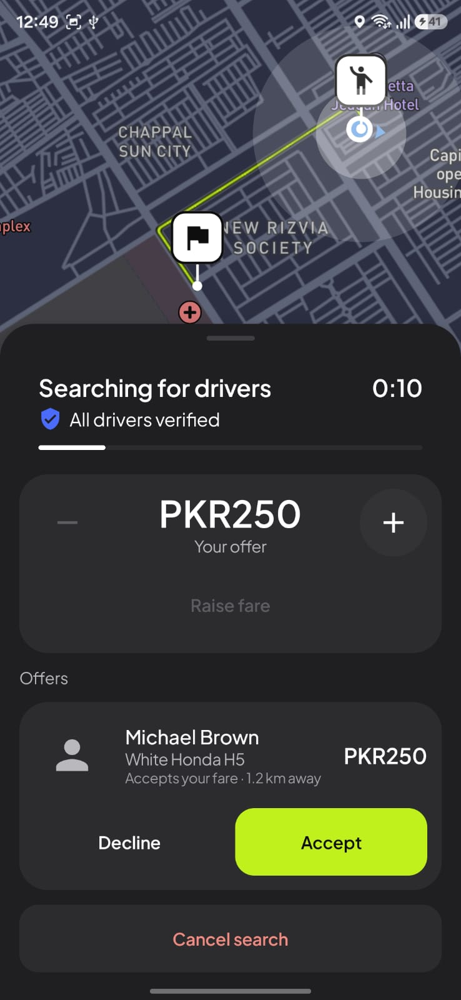<br/>Searching for a rider</td>
    <td align="center">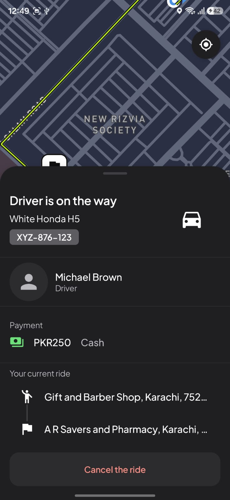<br/>Rider on the way</td>
  </tr>
  <tr>
    <td align="center">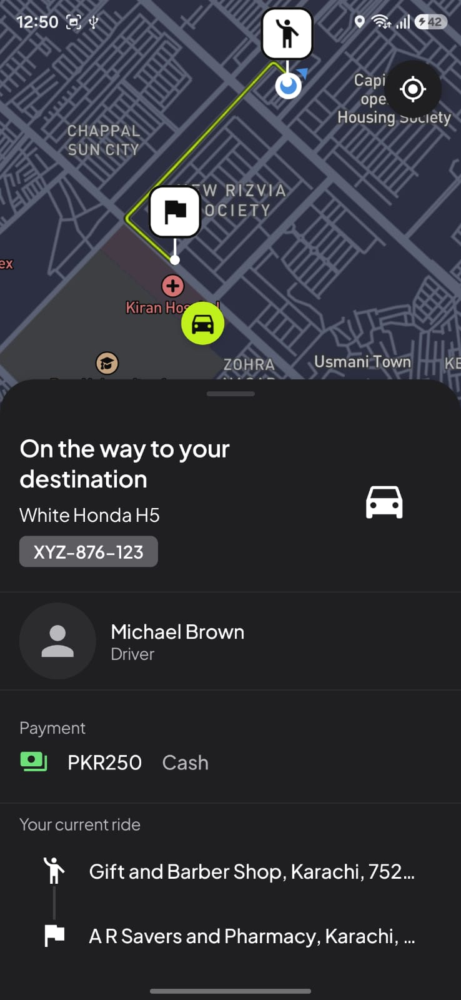<br/>Rider arriving</td>
    <td align="center">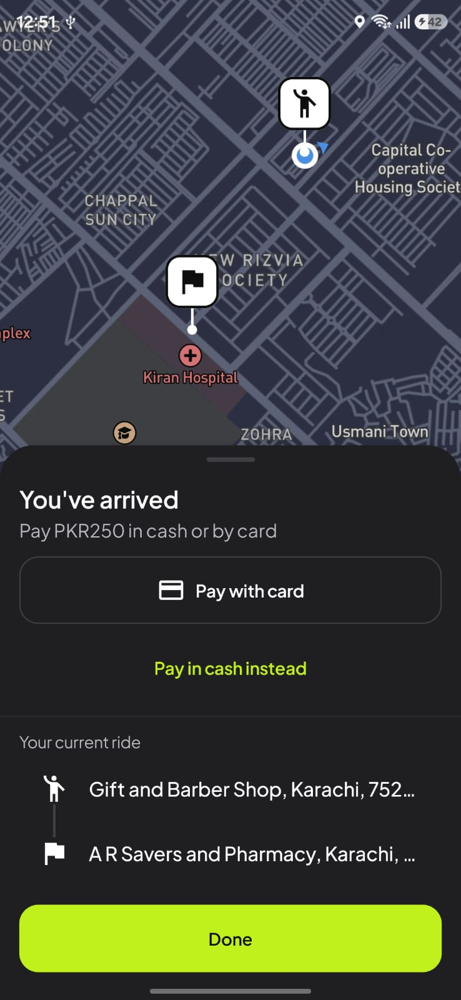<br/>Trip complete</td>
    <td align="center">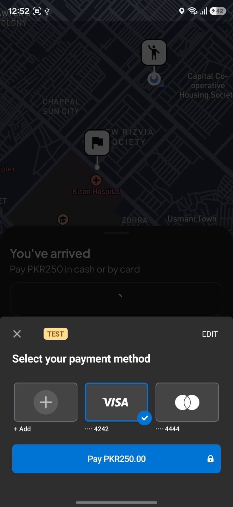<br/>Pay with card</td>
    <td></td>
  </tr>
</table>

### GoZipo Rider

<table>
  <tr>
    <td align="center">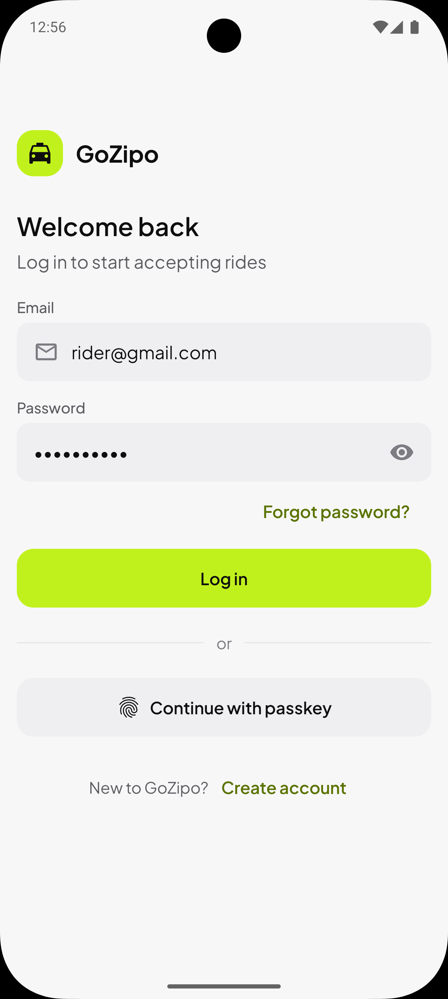<br/>Login</td>
    <td align="center">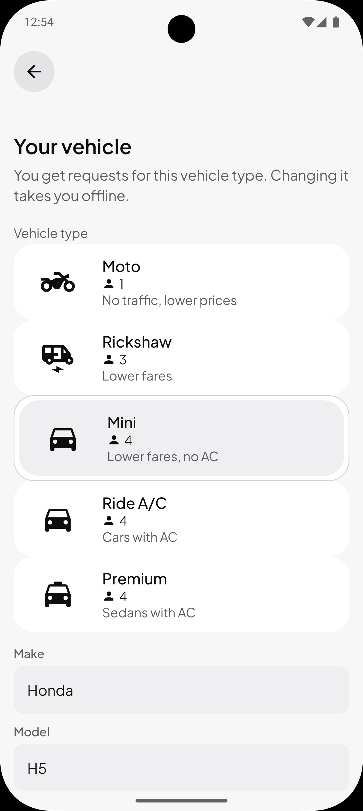<br/>Vehicle</td>
    <td align="center">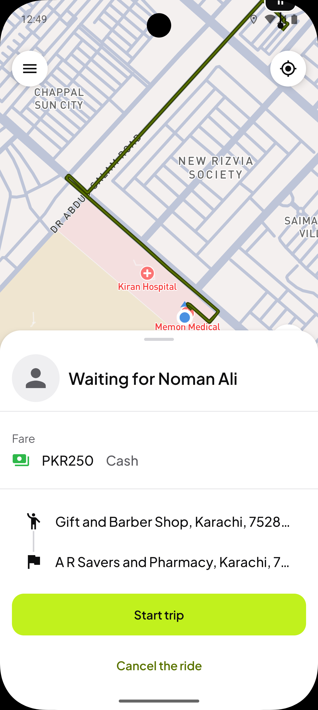<br/>Waiting for requests</td>
  </tr>
  <tr>
    <td align="center">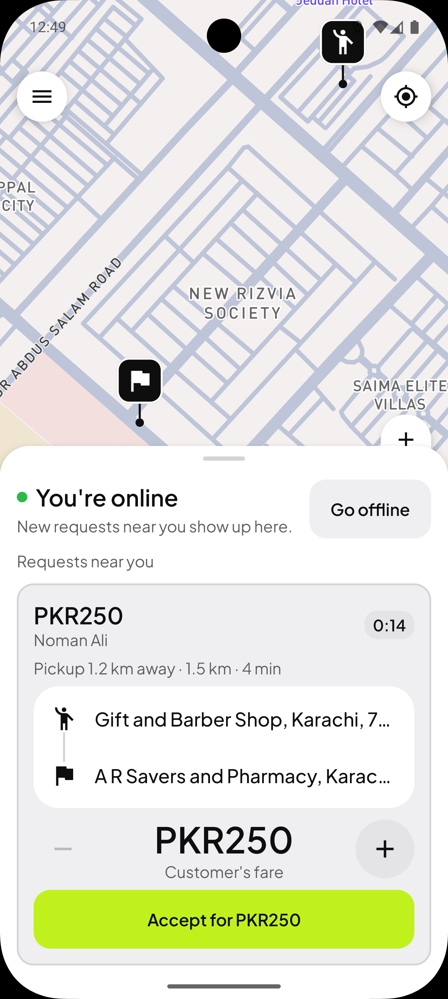<br/>Ride request</td>
    <td align="center">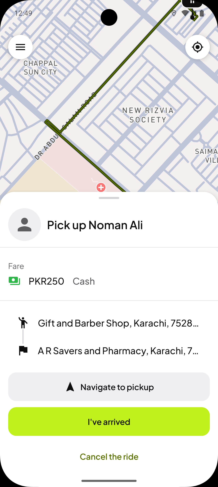<br/>Pickup</td>
    <td align="center">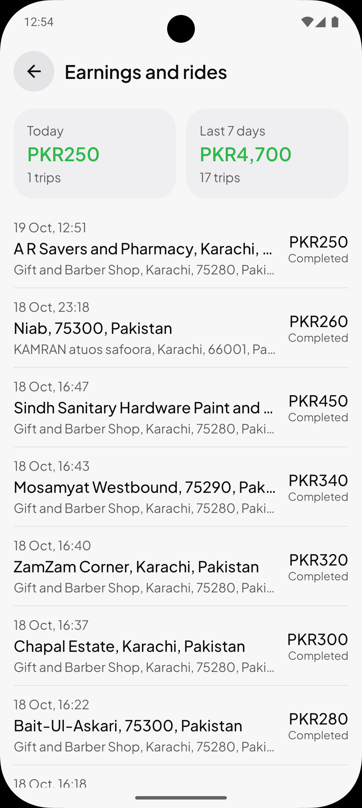<br/>Earnings</td>
  </tr>
</table>

## Tech stack

| Area | Libraries |
|---|---|
| Language and platforms | Kotlin 2.4, Kotlin Multiplatform (Android, iOS `arm64` and simulator `arm64`) |
| UI | Compose Multiplatform 1.12, Material 3, Navigation Compose (type-safe routes), Coil 3 |
| Architecture | Clean architecture (domain / data / presentation), MVI-style ViewModels, Koin 4 for dependency injection |
| Networking | Ktor 3 (REST and WebSocket), kotlinx.serialization, bearer auth with token refresh |
| Storage | DataStore |
| Maps | Mapbox Maps SDK 11, Mapbox Navigation SDK 3 (rider app), Mapbox Search and Directions APIs |
| Payments | Stripe PaymentSheet, FlowController and Embedded Payment Element (customer app) |
| Push | Firebase Cloud Messaging (Android and iOS) |
| Sign-in | Passkeys: Credential Manager (Android), AuthenticationServices (iOS) |
| Device | moko-permissions, Play Services location (Android), Core Location (iOS) |
| Other | kotlinx.coroutines, kotlinx.datetime, Kermit logging, BuildKonfig |
| Build | Gradle with convention plugins (`build-logic`), version catalog, AGP 9 |
| iOS shell | SwiftUI; Swift bridges for the Swift-only Mapbox and Stripe SDKs |
| Testing | kotlin.test, kotlinx-coroutines-test, Ktor MockEngine |

## Project structure

```
GoZipo/
├── apps/
│   ├── customer/            # GoZipo (customer) app
│   │   ├── shared/          #   composition root: navigation, Koin setup, iOS framework "CustomerShared"
│   │   ├── androidApp/      #   Android launcher
│   │   └── iosApp/          #   iOS launcher (SwiftUI) + Stripe bridge
│   ├── rider/               # GoZipo Rider app
│   │   ├── shared/          #   composition root, iOS framework "RiderShared"
│   │   ├── androidApp/
│   │   └── iosApp/          #   iOS launcher + Mapbox Navigation bridge
│   ├── common/              # App shell shared by both apps (session, deep links, push token)
│   └── ios-common/          # Swift code used by both iOS apps (Mapbox bridge, push setup)
│
├── core/
│   ├── domain/              # Pure Kotlin models, interfaces and the Result/error model
│   ├── data/                # Ktor client, session storage, realtime socket, push, platform code
│   ├── presentation/        # Shared UI utilities (UiText, events, permissions)
│   ├── designsystem/        # GoZipoTheme, typography, colors and shared components
│   ├── map/
│   │   ├── api/             # Provider-free map contract (GoZipoMap, camera, markers)
│   │   ├── mapbox/          # Mapbox implementation, search and directions
│   │   └── navigation/      # Turn-by-turn navigation (rider app only)
│   └── payment/
│       ├── api/             # Provider-free checkout contract
│       └── stripe/          # Stripe implementation (customer app only)
│
├── feature/
│   ├── auth/                # Sign-in, sign-up, passkeys, password reset (domain / data / presentation)
│   ├── ride/                # Shared ride models, REST, realtime events and ride UI
│   ├── booking/             # Customer ride screens (presentation)
│   ├── driving/             # Rider screens: vehicle, requests, trip, earnings (presentation)
│   └── payment/             # Card payments and saved cards (domain / data / presentation)
│
├── build-logic/             # Gradle convention plugins
├── gradle/libs.versions.toml
├── design/                  # UI reference images
└── screenshot/              # App screenshots used in this README
```

Each feature is split into `domain` (interfaces and models), `data` (Ktor implementations) and `presentation` (Compose screens and ViewModels). Mapbox and Stripe are used only inside their `core` modules, so either provider can be replaced without touching the features.

## Getting started

### Requirements

- Android Studio or IntelliJ IDEA with the Kotlin Multiplatform plugin
- Xcode for the iOS apps
- The GoZipo backend running locally on port 8080

### Configuration

Add these to `local.properties`:

```properties
API_KEY=...                  # required: sent as the x-api-key header
APP_LINK_HOST=...            # required: public HTTPS host of the email links
MAPBOX_ACCESS_TOKEN=pk....   # optional: Mapbox public token (maps show a placeholder without it)
STRIPE_PAYMENT_UI=PAYMENT_SHEET   # optional: PAYMENT_SHEET, FLOW_CONTROLLER or EMBEDDED
```

Both Android apps also need a `google-services.json` from the Firebase project.

### Build and run

- Android: `./gradlew :apps:customer:androidApp:assembleDebug` or `./gradlew :apps:rider:androidApp:assembleDebug`
- iOS: open `apps/customer/iosApp` or `apps/rider/iosApp` in Xcode and run

### Tests

- All tests in a module: `./gradlew :core:domain:allTests`
- iOS simulator: `./gradlew :feature:payment:presentation:iosSimulatorArm64Test`
- Android host: `./gradlew :apps:customer:shared:testAndroidHostTest`
